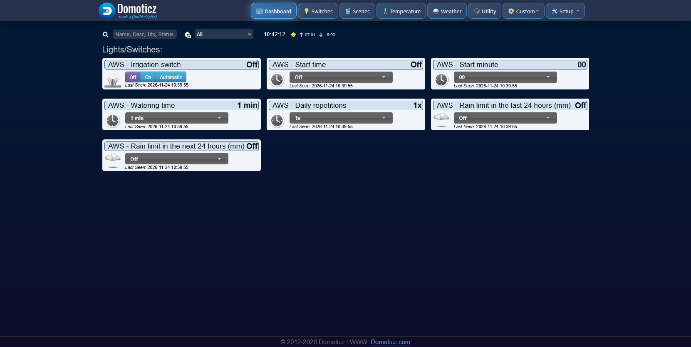
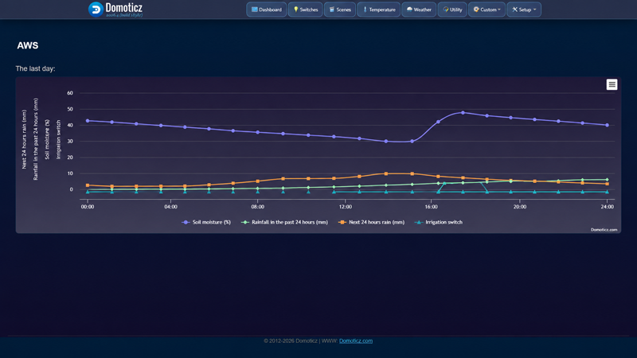
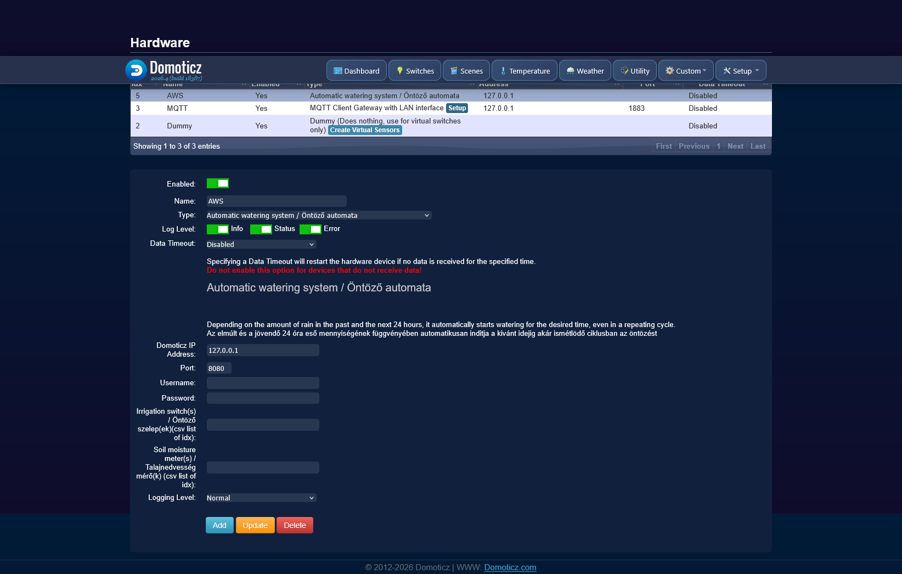

# Domoticz Automatic Watering System (AWS_OA)

**English** | [Magyar](#magyar)

Open-source irrigation control plugin for **Domoticz**, developed by [Szélessáv Műhely](https://www.szelessavmuhely.hu/hu/ontozes_vezerles). The system combines adjustable watering schedules with optional soil-moisture measurements and **Open-Meteo** precipitation data to avoid unnecessary irrigation.

**Plugin version described:** 1.4.0 (2026-11-19)

## Screenshots

### Irrigation dashboard



### Weather, soil moisture and irrigation history



*The graph is an illustrative demonstration, not a record of actual weather or irrigation measurements.*

### Hardware configuration



## Features

- **Off / On / Automatic** selector: stop irrigation, turn it on manually, or run according to automatic rules. Manual **On** remains active until the mode is changed.
- **1–24 watering cycles per day**, distributed at regular intervals from the configured starting time.
- **Watering duration:** 1, 2, 3, 4, 5, 10, 15, 20, 25 or 30 minutes.
- **Starting time:** hour (00–23) and minute (00–55, in five-minute steps).
- **Optional soil-moisture sensor(s):** the plugin averages the readings when multiple sensors are configured and compares the result to an adjustable **5–95%** threshold.
- **Open-Meteo precipitation monitoring:** calculates rainfall for the **previous 24 hours** and forecasts for the **next 24 hours**, refreshed every 30 minutes.
- **Separate precipitation thresholds:** 1–50 mm for each period, or monitoring can be disabled.
- **Multiple irrigation switches:** control multiple Domoticz switches together, not as independently scheduled zones.
- **Custom viewer:** graphs for soil moisture, past and forecast rain, and irrigation state.
- **Multilingual interface:** translation files supplied with the plugin and viewer.
- **Local control:** the Domoticz plugin controls locally integrated switches; an internet connection is required when Open-Meteo weather monitoring is enabled.

### How automatic watering works

At each scheduled watering window, the controller decides whether irrigation should run. With moisture sensors configured, it checks the average soil moisture and, when enabled, the **next 24-hour** rainfall forecast. Without moisture sensors, it can check **both past and forecast** precipitation thresholds. With no sensor or precipitation condition configured, it acts as a regular timer.

If precipitation monitoring is enabled but valid Open-Meteo data is unavailable, automatic watering is disabled as a precaution.

## Installation

Requires Domoticz with Python plugin support, Python 3, and at least one compatible irrigation switch integrated into Domoticz. A soil-moisture sensor is optional.

### 1. Install the plugin

Example for systems using `/etc/domoticz/plugins`:

```sh
cd /etc/domoticz/plugins
git clone https://github.com/szelessavalapitvany/Domoticz-Automatic-Watering-System.git AWS_OA
```

The resulting directory should contain `plugin.py` and the `aws_translate_*.json` translation files. Adapt the directory path if your Domoticz installation differs.

### 2. Install the optional custom viewer

If the repository contains the `viewer/` directory, copy its **contents** into your Domoticz `www/templates/` directory. For example:

```sh
cp -r /etc/domoticz/plugins/AWS_OA/viewer/* /usr/share/domoticz/www/templates/
```

Viewer files include `AWS_Ontozo_Automatic_watering.html`, `aws_viewer.js` and `aws_html_translate_*.json`. Check the actual locations on your system before running the command.

### 3. Configure location and API access

Set the correct **latitude and longitude** in Domoticz settings. Open-Meteo uses these coordinates; no OMSZ or ipdns.hu account is required.

The plugin communicates with the Domoticz HTTP API. Its default address and port are `127.0.0.1` and `8080`. Change them as appropriate, and provide a username/password if authentication is required.

### 4. Create the hardware device

Restart Domoticz, then go to **Setup → Hardware**, select **Automatic watering system / Öntöző automata**, and configure:

| Setting | Description |
| --- | --- |
| Domoticz IP Address / Port | Domoticz HTTP API connection |
| Username / Password | Optional API credentials |
| Irrigation switch(s) | Comma-separated switch IDX values, e.g. `123,124` |
| Soil moisture meter(s) | Optional comma-separated sensor IDX values |
| Logging Level | Normal or more detailed diagnostics |

Select the newly created devices in Domoticz to set the start time, watering duration, daily repetitions, and desired moisture/rain thresholds. Use **Automatic** mode to enable conditional watering.

### Updates

For a Git-based installation:

```sh
cd /etc/domoticz/plugins/AWS_OA
git pull
```

After updating, copy the viewer files again if necessary and restart Domoticz. Back up locally modified files before updating. On systems with limited storage, downloading the repository as a ZIP instead of keeping Git history may be preferable.

## Documentation

**English:**
- [Overview and features](https://www.szelessavmuhely.hu/en/irrigation_control)
- [Installation guide](https://www.szelessavmuhely.hu/en/irrigation_control/installation)
- [Settings and functions](https://www.szelessavmuhely.hu/en/irrigation_control/settings,_functions)

**Magyar:**
- [Áttekintés és funkciók](https://www.szelessavmuhely.hu/hu/ontozes_vezerles)
- [Telepítési útmutató](https://www.szelessavmuhely.hu/hu/ontozes_vezerles/telepites)
- [Beállítások és funkciók](https://www.szelessavmuhely.hu/hu/ontozes_vezerles/beallitas,_funkciok)

[Project repository](https://github.com/szelessavalapitvany/Domoticz-Automatic-Watering-System)

---

<a id="magyar"></a>

# Domoticz öntözőautomata (AWS_OA)

**[English](#domoticz-automatic-watering-system-aws_oa)** | **Magyar**

Nyílt forráskódú öntözésvezérlő plugin **Domoticz** rendszerhez, a [Szélessáv Műhely](https://www.szelessavmuhely.hu/hu/ontozes_vezerles) fejlesztésében. A rendszer az időzített öntözést opcionális talajnedvesség-méréssel és az **Open-Meteo** csapadékadataival egészíti ki, hogy elkerülhető legyen a felesleges öntözés.

**A leírás alapjául szolgáló pluginverzió:** 1.4.0 (2026. 11. 19.)

## Képernyőképek

### Öntözésvezérlő kezelőfelület


### Időjárás-, talajnedvesség- és öntözési grafikon


*A grafikon szemléltető demóadatokat tartalmaz, nem tényleges időjárási vagy öntözési mérési eredményeket.*

### Hardverbeállítások


## Funkciók

- **Ki / Be / Automata** főkapcsoló: az öntözés leállítása, kézi bekapcsolása vagy automatikus vezérlése. A kézi **Be** állapot módváltásig aktív marad.
- **Napi 1–24 öntözési ciklus**, a beállított kezdőidőponttól egyenletes időközökkel elosztva.
- **Öntözési időtartam:** 1, 2, 3, 4, 5, 10, 15, 20, 25 vagy 30 perc.
- **Kezdés:** 00–23 óra között, a perc 5 perces lépésekben adható meg.
- **Opcionális talajnedvesség-érzékelők:** több érzékelő esetén a mért értékeket átlagolja; a küszöbérték **5–95%** között állítható.
- **Open-Meteo csapadékfigyelés:** az **elmúlt 24 óra** csapadékát és a **következő 24 óra** várható csapadékát számítja, 30 percenkénti adatfrissítéssel.
- **Külön csapadékhatárok:** mindkét időszakra 1–50 mm között, vagy külön kikapcsolhatók.
- **Több öntözőkapcsoló:** egyszerre kapcsolható eszközök, nem külön ütemezett öntözési zónák.
- **Egyedi grafikus megjelenítő:** talajnedvesség, múltbeli és várható csapadék, valamint az öntözés kapcsolási állapota.
- **Többnyelvű felület:** a plugin és a megjelenítő fordítási fájljaival.
- **Helyi vezérlés:** a Domoticz a helyileg integrált kapcsolókat vezérli; az Open-Meteo használatához internetkapcsolat szükséges.

### Az automatikus működés logikája

A beállított öntözési időablakokban a vezérlő megvizsgálja a feltételeket. Talajnedvesség-érzékelő esetén a mért átlagot és – ha engedélyezett – a **következő 24 órára várható** csapadékot figyeli. Érzékelő nélkül a **múltbeli és a várható** csapadékhatár is alkalmazható. Ha egyik érzékelős vagy csapadékfeltétel sincs bekapcsolva, hagyományos időzítőként működik.

Aktív csapadékfigyelés mellett érvényes Open-Meteo adatok hiányában a rendszer biztonsági okból nem indít automatikus öntözést.

## Telepítés

A használathoz Python pluginokat támogató Domoticz, Python 3 és legalább egy, a Domoticzban elérhető öntözőkapcsoló szükséges. Talajnedvesség-érzékelő nem kötelező.

### 1. Plugin telepítése

Példa az `/etc/domoticz/plugins` könyvtárat használó rendszerekhez:

```sh
cd /etc/domoticz/plugins
git clone https://github.com/szelessavalapitvany/Domoticz-Automatic-Watering-System.git AWS_OA
```

A létrejövő könyvtárban legyen megtalálható a `plugin.py` és az `aws_translate_*.json` fordítási fájlok. Más Domoticz telepítés esetén az elérési utat módosítani kell.

### 2. Egyedi webes megjelenítő telepítése

Amennyiben a repositoryban megtalálható a `viewer/` könyvtár, annak **tartalmát** kell bemásolni a Domoticz `www/templates/` könyvtárába. Például:

```sh
cp -r /etc/domoticz/plugins/AWS_OA/viewer/* /usr/share/domoticz/www/templates/
```

A megjelenítő fájljai között szerepel az `AWS_Ontozo_Automatic_watering.html`, az `aws_viewer.js` és az `aws_html_translate_*.json`. A parancs futtatása előtt ellenőrizd a tényleges telepítési útvonalakat.

### 3. Helyadatok és API-hozzáférés

A Domoticz beállításainál add meg a helyes **földrajzi szélességet és hosszúságot**. Az Open-Meteo ezeket használja, külön OMSZ- vagy ipdns.hu-fiók nem szükséges.

A plugin a Domoticz HTTP API-t használja. Az alapértelmezett cím `127.0.0.1`, a port `8080`. Szükség esetén módosítsd ezeket, illetve adj meg felhasználónevet és jelszót.

### 4. Hardver létrehozása

Indítsd újra a Domoticz szolgáltatást, majd a **Beállítások → Hardver** menüben válaszd az **Automatic watering system / Öntöző automata** típust.

| Beállítás | Leírás |
| --- | --- |
| Domoticz IP Address / Port | Domoticz HTTP API elérése |
| Username / Password | Opcionális API-hitelesítés |
| Öntöző szelep(ek) | Kapcsolók IDX értékei vesszővel elválasztva, pl. `123,124` |
| Talajnedvesség mérő(k) | Érzékelők opcionális IDX listája |
| Logging Level | Normál vagy részletesebb naplózás |

Az újonnan létrehozott Domoticz eszközökkel állítsd be a kezdőidőt, időtartamot, napi ismétlést és a kívánt nedvesség-/csapadékhatárokat. A feltételes vezérléshez válaszd az **Automata** módot.

### Frissítés

Git-alapú telepítésnél:

```sh
cd /etc/domoticz/plugins/AWS_OA
git pull
```

Szükség esetén másold újra a megjelenítő fájljait, majd indítsd újra a Domoticz szolgáltatást. A helyben módosított fájlokról előtte készíts mentést. Korlátozott tárhelyű rendszernél a teljes Git-előzmény helyett ZIP-es letöltés is használható.

## Részletes dokumentáció

**Magyar:**
- [Áttekintés, funkciók](https://www.szelessavmuhely.hu/hu/ontozes_vezerles)
- [Telepítés](https://www.szelessavmuhely.hu/hu/ontozes_vezerles/telepites)
- [Beállítások és funkciók](https://www.szelessavmuhely.hu/hu/ontozes_vezerles/beallitas,_funkciok)

**English:**
- [Overview and features](https://www.szelessavmuhely.hu/en/irrigation_control)
- [Installation guide](https://www.szelessavmuhely.hu/en/irrigation_control/installation)
- [Settings and functions](https://www.szelessavmuhely.hu/en/irrigation_control/settings,_functions)

[GitHub repository](https://github.com/szelessavalapitvany/Domoticz-Automatic-Watering-System)
